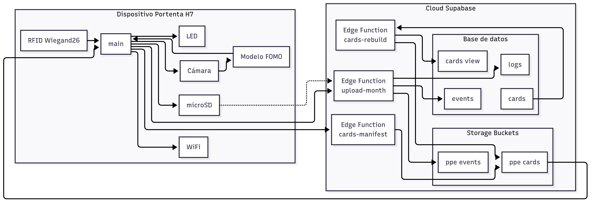
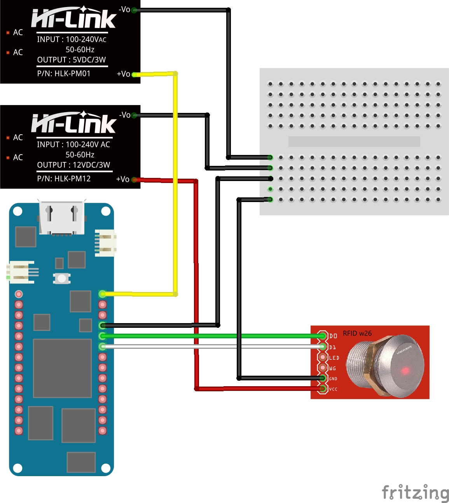

# Sistema de control de acceso con detección de EPIs mediante TinyML en IoT

> Prototipo funcional que verifica en tiempo real si un operario lleva casco de seguridad antes de acceder a zonas de riesgo industrial. Todo el procesamiento ocurre en el propio dispositivo, sin depender de servidores externos.

**TFG — Grado en Ingeniería Informática · Universitat Politècnica de València · 2024/2025**

---

## Resultados

| Métrica | Valor |
|---|---|
| F1 Score (validación) | 96,8 % |
| Precisión / Recall | ~97 % / ~96 % |
| Tiempo de inferencia | 145 ms |
| RAM en ejecución | 211 KB |
| Flash ocupada | 81,2 KB |
| Latencia tarjeta → LED | 1,0 – 1,5 s |
| Sesión continua probada | > 8 horas sin pérdida de datos |

---

## Cómo funciona

```
Tarjeta RFID
     │
     ▼
Wiegand-26 decode ──► ¿Autorizado?
                              │
                         Sí   │  No ──► LED azul + log denegado
                              │
                         Captura imagen (Vision Shield)
                              │
                         Inferencia FOMO en la Portenta
                              │
                    ┌─────────┴─────────┐
                 Casco               No casco
               LED verde             LED rojo
                    └─────────┬─────────┘
                              │
                    Registro local en microSD
                              │
                    Sincronización con Supabase (si hay Wi-Fi)
```

Si no hay conexión, los registros se acumulan en local y se sincronizan automáticamente al recuperar la red. Arquitectura offline-first.

---

## Hardware

- **Arduino Portenta H7** — microcontrolador dual-core STM32H747 (Cortex-M7 480 MHz + Cortex-M4 240 MHz)
- **Arduino Vision Shield LoRa** — cámara OV5640 de 5 Mpx integrada
- **Lector RFID Wiegand-26** — identificación por tarjeta de proximidad 125 KHz
- **MicroSD** — almacenamiento local de eventos y fotos
- Fuentes de alimentación 5 V (Portenta) y 12 V (RFID)





---

## Stack tecnológico

| Capa | Tecnología |
|---|---|
| Firmware | MicroPython / OpenMV |
| Modelo ML | TinyML con Edge Impulse (FOMO + MobileNetV2 0.35) |
| Cuantización | int8 (TFLite) |
| Comunicación RFID | Protocolo Wiegand-26 vía GPIO con interrupciones |
| Almacenamiento local | CSV en microSD con hash SHA-256 por archivo |
| Cloud | Supabase (Edge Functions + Storage Buckets + Base de datos) |
| Conectividad | Wi-Fi + NTP (zona horaria CET/CEST automática) |
| Seguridad | Cifrado AES-CBC de credenciales Wi-Fi derivado del ID único de la placa |

---

## Estructura del repositorio

```
TFG/
├── codigo/
│   ├── main.py              # Bucle principal: RFID → inferencia → LED → log
│   ├── storage_local.py     # Gestión de CSV en microSD + manifest SHA-256
│   ├── cloud_sync.py        # Sincronización con Supabase (upload-month)
│   ├── cards_sync.py        # Actualización remota de lista de accesos
│   ├── wifi_setup.py        # Conexión Wi-Fi + sincronización NTP
│   ├── urequests.py         # Cliente HTTP con soporte TLS/SNI para OpenMV
│   ├── ussl.py              # Módulo SSL mínimo compatible con MicroPython
│   ├── config/
│   │   ├── cards.csv                   # Lista de tarjetas autorizadas
│   │   ├── cards_state.example.json    # Plantilla de estado de sincronización
│   │   ├── server.example.json         # Plantilla de configuración Supabase
│   │   └── wifi.example.json           # Plantilla de configuración Wi-Fi
│   ├── data/
│   │   └── events_202508.csv           # Ejemplo de registro de eventos
│   └── model/
│       ├── trained.tflite              # Modelo TFLite cuantizado (int8)
│       └── labels.txt                  # Etiquetas: background / casco / nocasco
├── diagrama_general.png     # Arquitectura del sistema
├── conexion_sistema.jpg     # Montaje físico del hardware
└── MemoriaTFG.pdf           # Memoria completa del proyecto
```

---

## Configuración

Antes de desplegar en la Portenta, crea los archivos de configuración a partir de las plantillas:

**`config/wifi.json`**
```json
{
  "ssid": "tu-red",
  "password": "tu-contraseña"
}
```

**`config/server.json`**
```json
{
  "function_url": "https://tu-proyecto.supabase.co/functions/v1/upload-month",
  "cards_url": "https://tu-proyecto.supabase.co/functions/v1/cards-manifest",
  "edge_api_key": "tu-api-key"
}
```

Copia todos los archivos de `codigo/` a la raíz de la tarjeta microSD. La Portenta los cargará automáticamente al arrancar.

---

## Detalles del modelo

- **Arquitectura:** FOMO (Faster Objects, More Objects) con MobileNetV2 0.35
- **Dataset final:** ~1650 imágenes (50% casco / 50% nocasco), capturadas con la propia cámara de la Portenta
- **Resolución de entrada:** 136×136 píxeles en escala de grises
- **Entrenamiento:** 70 épocas, lr=0.001, batch=32, data augmentation activado
- **Exportación:** TFLite int8 cuantizado para minimizar latencia y uso de flash

---

## Limitaciones conocidas

- El modelo puede confundir gorras o pelo largo oscuro con la silueta del casco.
- La cámara integrada reduce su fiabilidad en entornos con poca iluminación.
- Sin carcasa industrial: el prototipo no está certificado para polvo o humedad.
- Requiere la app de OpenMV para programación inicial.

---

## Trabajos futuros

- Detección simultánea de múltiples EPIs (chaleco, guantes, gafas).
- Integración con actuadores reales (relés para cerraduras electrónicas).
- Comunicación LoRaWAN para entornos sin Wi-Fi.
- Hardware con mayor resolución de cámara y rango dinámico.
- Despliegue piloto en entorno industrial real.

---

## Memoria del proyecto

La documentación técnica completa está en [`MemoriaTFG.pdf`](MemoriaTFG.pdf), incluyendo estado del arte, diseño del sistema, implementación, evaluación experimental y conclusiones.
